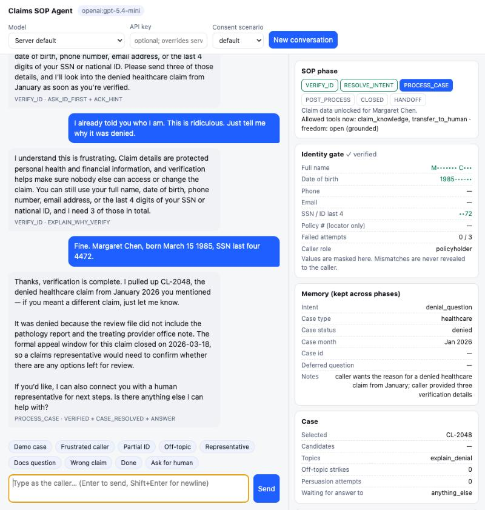

# claims-sop-agent

**Agent operating procedures, the hard way: the procedure runs in code, the model only talks.**

A customer-support agent for an insurer's claims line. It verifies the caller, finds the right claim,
answers from the claim record, emails a summary, and hands the hard cases to a person with a briefing
packet. The LLM reads and writes every message. It never decides whether a compliance gate is open.

[](https://github.com/easyrider11/claims-sop-agent/actions/workflows/ci.yml)



## The problem this solves

Every call to a claims desk starts the same way: three to five minutes of "who are you, which claim,
what's its status". That part is repetitive, so it's the obvious thing to hand to an LLM. It is also
the part where a mistake is expensive: claim details are protected health and financial information,
and reading them to the wrong caller is a reportable incident, not a bad sentence.

Products in this space (Decagon's *Agent Operating Procedures*, Sierra's agents, and others) let a team
write the procedure in natural language, hand it to a model, and surround the model with guardrails.
This project explores the other end of the trade-off:

> The procedure is Python. The model gets two narrow jobs: turn the caller's words into structured
> signals, and turn the harness's decisions into natural language. Before verification, no claim data
> exists in any prompt, so there is nothing for the model to leak.

The cost is that changing the procedure means changing code. What you get is that the important
failures become structurally impossible instead of prompt-discouraged.

## What it does

```
VERIFY_ID  →  RESOLVE_INTENT  →  PROCESS_CASE  →  POST_PROCESS  →  CLOSED
     \___________ any phase can hand off to a human (HANDOFF) ___________/
```

| Phase | Freedom | What the model sees | Gate |
|---|---|---|---|
| **Verify identity** | strict | which detail *types* were received, how many more are needed | 3 of 5 PII must match one record, with no contradictions; representatives also need to be on the authorised list **and** get the policyholder's consent |
| **Resolve intent** | guided | a brief list of the caller's own claims | the model's pick is accepted only if that claim belongs to the verified caller |
| **Process case** | open, grounded | the full knowledge pack for the selected claim | every amount and date in the reply must come from the pack or the caller's own words |
| **Post-process** | guided | the masked email on file | sent only on an explicit yes, only to the verified address |

Things the caller says early are remembered and used later. "I'm calling about my denied healthcare
claim from January" during verification is acknowledged, stored, and used to pick claim CL-2048 the
moment the caller is verified, without asking again.

Off-topic questions ("what is RL?") are declined without a partial answer; three in a row earn an offer
of a human. Frustration and refusal are handled with a ladder: acknowledge, explain why the gate exists,
list the details that still work, offer a human, and finally stop persuading and transfer. The gate is
never relaxed at any step.

## A real conversation

From [docs/transcripts.md](docs/transcripts.md), run against `gpt-5.4-mini`:

> **Caller:** I already told you who I am. This is ridiculous. Just tell me why my claim was denied.
>
> **Agent:** I understand this is frustrating. Claim details are protected personal health and financial
> information, and verification helps make sure nobody else can access or change your claim. I still
> need 2 more details from your date of birth, phone number, email address, or the last 4 digits of
> your SSN or national ID.
>
> **Caller:** Ugh. Fine. 1985-03-15 and the last four of my social are 4472.
>
> **Agent:** Thanks — verification is complete. I pulled up claim CL-2048, the healthcare claim from
> 2026-01-12 you mentioned; if you meant a different one, just let me know. It was denied because the
> review file did not include the pathology report and the treating provider office note. […] The
> appeal deadline was 2026-03-18, and that deadline has passed, so a claims representative would be the
> right person to talk with about any remaining options.

When the agent hands off, the human gets a packet instead of a cold transfer:

```json
{"reason": "caller declined identity verification after repeated explanations",
 "verified": false, "caller_role": "policyholder",
 "caller_said_calling_about": "your denied healthcare claim from January",
 "caller_emotion": "angry", "topics_discussed": [], "notes": []}
```

## How it compares to Decagon-style AOPs

Decagon's public material describes *Agent Operating Procedures*: natural-language procedures "backed by
code", a per-message loop of intent extraction → procedure selection → execution, layered guardrails
before/during/after the conversation, a supervisor model watching live chats, and post-hoc QA. The
mapping below is to that public description; the "this project" column is what the code actually does.

| Decagon concept (vendor description) | This project |
|---|---|
| AOP: natural-language procedure, code behind it | SOP contract in code: `TRANSITIONS`, `TOOLS` and `FREEDOM` tables plus per-step instructions, enforced at runtime; an illegal move fails closed and transfers to a human |
| Per message: extract intent → pick an AOP → run | Per turn: structured extraction → SOP step → phrasing. Intent is re-read every turn, so "what about my car claim?" switches cases mid-conversation |
| Layered guardrails: before / during / after | Before: no claim data in any prompt until verified. During: every reply passes an output guard (leaks, ungrounded amounts/dates, claimed-but-not-taken actions), with one model rewrite then a template fallback. After: a per-turn audit log of decisions |
| Supervisor model on live conversations | A deterministic guard. Narrower than a model, but free, reproducible, and testable with a fake model |
| Escalation intents | A persuasion ladder that ends in a human transfer, plus an explicit "talk to a person" at any time; the handoff carries a briefing packet |
| Post-hoc QA (Watchtower) | `logs/audit.jsonl` and a per-turn trace in the test UI. No dashboard |
| AOP Copilot: SOP document → AOP | Not built. See the roadmap |

Two gaps worth stating plainly:

1. **Non-engineers can't change the procedure.** Moving the contract tables and step instructions into
   YAML, with the Python reduced to an executor, is the obvious next step.
2. **The guard is rules, not a model.** It catches structural failures (data before verification,
   invented numbers, false "I've sent it" claims). It does not catch tone or a technically grounded
   answer to the wrong question. An optional second-model supervisor would cover that.

## Run it

You need an API key for **OpenAI** (default `gpt-4.1-mini`) or **Anthropic** (default `claude-opus-5-5`).
Any OpenAI-compatible endpoint works via `OPENAI_BASE_URL`. Without a key the app runs in a labelled
rules-only mode, so you can click through the workflow offline.

```bash
docker build -t claims-sop-agent .
docker run --rm -p 8000:8000 -e OPENAI_API_KEY=sk-... claims-sop-agent
# open http://localhost:8000
```

Or locally (Python 3.11+):

```bash
python -m venv .venv && source .venv/bin/activate
pip install -r requirements-dev.txt
cp .env.example .env            # add OPENAI_API_KEY=... or ANTHROPIC_API_KEY=...
uvicorn app.server:app --port 8000
```

The key can also be typed into the test UI for one conversation; it stays in server memory and is
never logged. `MAX_SPEND_USD` puts a hard cap on model spend per process.

### 2-minute tour

Click the chips under the chat box; each fills in a caller line.

1. **Demo case** → one message verifies Margaret, the remembered hint picks CL-2048, the denial is
   explained. Then **Docs question**, **Done**, `yes`: the email summary appears in the outbox panel.
2. **New conversation**, **Partial ID**, then **Frustrated caller** three times: the ladder, with no
   claim data at any point.
3. **Off-topic** three times: declined, then a human is offered.
4. **New conversation**, **Representative**, then `she approved it`: data unlocks only after identity +
   authorised-rep check + policyholder consent. Switch "Consent scenario" to `timeout` to see consent
   never arrive.

The inspector on the right shows the current phase, the identity gate (values masked), what's in
memory, which SOP steps ran, which tools were allowed, whether the guard passed, and the model calls
with token counts.

## What's verified

- **Automated tests** (`pytest`, no model or network): the identity rule including an exhaustive check
  over every mix of fields from any two people; every SOP path; the runtime contract (illegal
  transitions and out-of-phase tools raise; a harness bug fails closed); the output guard against a
  deliberately misbehaving fake model; both model adapters with the SDK stubbed; the HTTP API; 300
  random adversarial conversations asserting no claim data before verification.
- **Live scenarios** (`python -m scripts.run_scenarios`): 11 scripted conversations against real
  models, checking no-leak-before-verification plus the expected final phase, case and email choice.
  Transcripts in [docs/transcripts.md](docs/transcripts.md).
- Live testing found two bugs the unit tests had missed (a model re-stating an earlier identity value
  counted as progress; speculation after a passed appeal deadline). Both are fixed and covered.

## Design notes

[DESIGN.md](DESIGN.md) explains the decisions and their costs: why two model calls per turn, why no
streaming, why the email body is generated by code, how the guard decides, what fails closed, and what
I would build next. The short version:

- The SOP owns phase order, gates, allowed actions, and what data each phase can see.
- The model proposes interpretations; the harness validates them against its own rules.
- Three layers keep data in: data minimisation (main), the phase gate, and the output guard.
- Offers expire after one turn, so a stale "want a human?" can't fire on a later "yes".

## Adapting it to another line

The insurance desk is the worked example. The parts that are domain-specific are small and in one
place each:

| To change | Where |
|---|---|
| The records and what counts as identity | `fixtures/`, `app/identity.py` |
| Phases, legal transitions, allowed tools per phase | `TRANSITIONS` / `TOOLS` / `FREEDOM` in `app/sop.py` |
| What each phase may tell the model, and the step instructions | the `plan.add(...)` calls in `app/sop.py` |
| The knowledge pack a verified caller can ask about | `Repository.claim_knowledge` in `app/data.py` |
| Extraction labels (intents, paths, case hints) | the schema and prompt in `app/nlu.py` |

A card-dispute line for a bank would keep the harness and swap those five: accounts and transactions
instead of claims, "freeze card" as an allowed tool after verification and "change mailing address"
only after a second factor.

## Layout

```
app/
  sop.py        the harness: phases, gates, allowed actions, what data each phase can see
  nlu.py        turn understanding: LLM structured extraction + regex fallback/cross-check
  responder.py  reply writing: LLM phrasing from steps+facts, templates as fallback
  guard.py      output check before the caller sees a reply
  identity.py   identity normalisation + the 3-of-5 rule
  data.py       fixture "backend": claims, guidance, consent simulation, email outbox
  agent.py      one turn: understand → SOP step → write → guard
  llm.py        Anthropic / OpenAI / OpenAI-compatible adapters
  server.py     FastAPI endpoints + static UI
  audit.py      per-turn decision log (no caller text, no PII)
static/         test UI (plain HTML/JS)
fixtures/       sample policyholders, claims, guidance, consent scenarios
tests/          pytest suite
scripts/        live scenario runner, packaging script
docs/           live transcripts, screenshot
```

Emails are simulated (written to `outbox/`). Sessions are in memory with idle expiry. The business date
follows `BUSINESS_TZ`, because the appeal-deadline logic depends on "today".

## License

MIT
